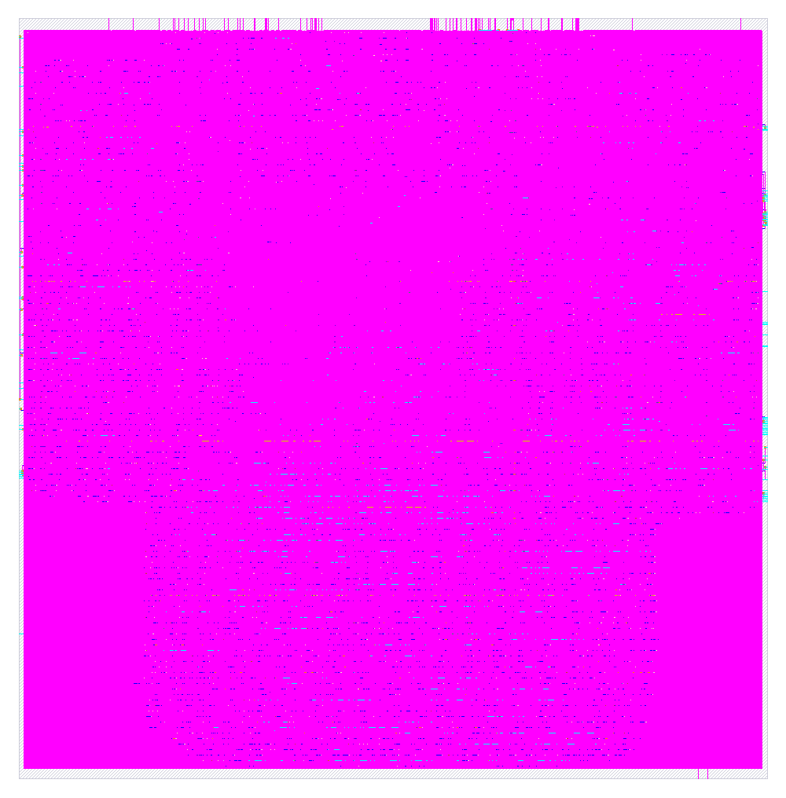

# RISC-V RTL to GDSII

Physical implementation of a cached five-stage RV32I integer core using
LibreLane 3.0.16, OpenROAD, Yosys/Slang, and SKY130A high-density standard cells.
This is a **core-macro portfolio project**, not a fabricated chip or tapeout.



## Results

| Check | Result |
|---|---|
| Clock target | 20 MHz (50 ns period) |
| Worst extracted setup slack | +23.107 ns |
| Worst extracted hold/removal slack | +0.0383 ns |
| DRC / LVS / antenna | Passed flow checks |
| Synthesis cell count | 15,066 |
| Synthesis standard-cell area | 185,574 µm² (0.1856 mm²; not die area) |
| RTL regressions | Four CPU configurations, two cache configurations, eight fault/reset cases passed |

**Remaining limitations:** slow-corner maximum slew and capacitance violations
are reported. The run also reports floating-net, intermediate route-estimation,
and pin-antenna metadata warnings. Formal equivalence was not run. IR-drop
analysis lacks a chip-level voltage-source model. This is not full electrical
or foundry signoff. See `results/warning.log` and the retained reports.

## Design

- Five-stage integer pipeline with forwarding, stalls, redirects, and fail-stop faults.
- Separate blocking, direct-mapped instruction and data caches: 64 bytes each.
- Write-back/write-allocate data cache; standard-cell storage, no SRAM macros.
- External instruction/data request-response interfaces.
- ASIC wrapper omits retirement trace and counters from the physical pins.
- No pad ring, PLL, interrupts, privileged-mode traps, scan, or external memory.

See [core documentation](pipeline_cache/README.md) for the supported instruction
set and verification limitations. This is not a complete privileged RISC-V system.

## Contents

- `pipeline_cache/rtl/`: original SystemVerilog design.
- `pipeline_cache/tb/`: CPU differential, cache, and fault tests.
- `pipeline_cache/asic/`: wrapper, constraints, configuration, and launcher.
- `results/final/`: GDSII, LEF, DEF, netlists, SDC, SPEF, SDF, Liberty,
  OpenROAD database, metrics, and layout render.
- `results/reports/`: extracted timing and physical verification evidence.
- `results/provenance.json`: tool/PDK identifiers and successful-run history.
- `SHA256SUMS`: integrity hashes for the exported source and result files.

Large generated files are losslessly gzip-compressed to keep this repository
manageable. For example, extract the main GDS to a separate directory:

```bash
mkdir -p build
gzip -dc results/final/gds/pipeline_cache_asic.gds.gz > build/pipeline_cache_asic.gds
```

The tools, PDK, intermediate implementation runs, and original Git history are
not included. Reports can contain original workstation paths as provenance;
those paths are not requirements for fresh runs.

## Reproduce

Install Verilator and the LibreLane 3.0.16 x86_64 AppImage from
https://github.com/librelane/librelane/releases/tag/3.0.16 .

Expected AppImage SHA-256:
`428df0d6d7ce167de6a31bc46001f1167b7fb1fbc1ed95fba278367a95883147`.

Use SKY130 PDK revision `8afc8346a57fe1ab7934ba5a6056ea8b43078e71`.
Obtain tools and PDK separately under their upstream licenses; no download is
performed by this repository's launcher itself (LibreLane may fetch a missing PDK).

```bash
make -f pipeline_cache/Makefile test
export LIBRELANE_APPIMAGE="$HOME/eda/appimages/librelane-3.0.16-x86_64.AppImage"
export PDK_ROOT="$HOME/eda/pdks"
bash pipeline_cache/asic/run.sh synth
# Review synthesis/constraints first, then:
bash pipeline_cache/asic/run.sh full
```

The published implementation resumed from a previously saved post-placement
checkpoint after switching from Nix to the same-version AppImage. A fresh full
run uses the exported final configuration; bit-for-bit reproduction across
tool packaging/platform changes is not claimed. Source and constraints are
included; the external resume checkpoint is not required for a fresh full run.

Timing assumes same-clock external logic, 1–10 ns I/O delays, and 20 fF output
loads. Reset release must satisfy recovery/removal timing. These are provisional
macro integration assumptions, not board-level timing specifications.

## Origin

Exported from https://github.com/ramselvaraj/riscv (`pipeline_cache`).
Third-party tools and SKY130 libraries retain their upstream licenses.
